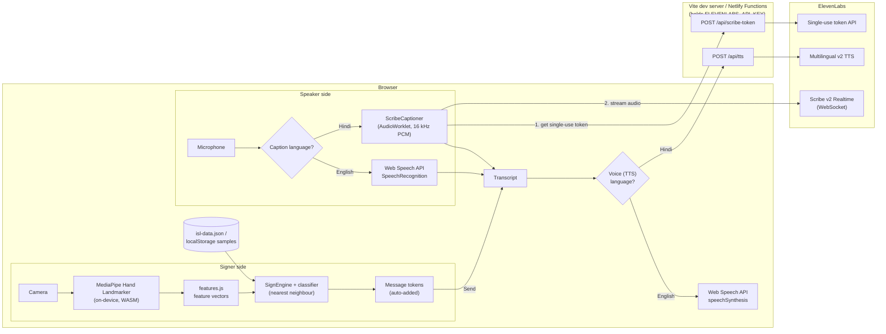

# Welcome to SignLens, developed by `Console.log("Custard")`
A focused Indian Sign Language (ISL) based Sign-to-text-and-speech service. All you need to do is open [SignLens](https://signlenscustardiitj.netlify.app/) and do the signs. And? -- wait for the magic to happen :)  

## How to converse with SignLens?

- **Step 1** — Click on [SignLens](https://signlenscustardiitj.netlify.app/) or go to https://signlenscustardiitj.netlify.app/ 
- **Step 2** — Go to the `Conversation` tab and click on the `Start Camera` under the `Signer` section to start signing. The camera will detect your signs, one word at a time. (Video stays on this device — only hand landmarks are analysed. Your privacy is taken care of.) 
- **Step 3** The words you sign will come down below one by one. You can click on `Send & Speak` to send it to the `Speaker` section as it is read aloud. Alternatively, one may go to the `Speaker`section and click on the *Microphone* icon to start talking as it identifies your words one by one. All the text in the panel below can be attempted to be read aloud by clicking on the *Speaker* icon. Clicking on the `Export`button will allow you to download the text as an `.txt` file. 
  
- **That's all** - Yes, that is all you have to do. And everything is supported in both languages: English and Hindi. Use the sliders `English | हिन्दी ` - besides both the sections to switch between English and Hindi.

## Architecture

SignLens is a single-page **Vue 3 (Options API) + Vite** app that helps an Indian Sign Language (ISL) signer and an English/Hindi speaker talk to each other. Almost everything runs in the browser. The only server-side code is two small endpoints that keep the ElevenLabs API key secret, plus a dev-only endpoint that writes the training data file.

---

## Customisation and Privacy
You can use the following buttons and options in the way elaborated:
### `Settings `

Use the `Settings` page to customize the application's behavior, accessibility features, and privacy preferences.

- Use the `Appearance` section to switch between `System`, `Light`, and `Dark` themes.
- Use the `Hindi Speech Engine (Captions & Voice)` section to select the speech engine for Hindi captions and voice output.
- Adjust the `Caption & Message Text Size` slider to increase or decrease text size.
- Configure the `Recognition Strictness` slider to control sign recognition sensitivity and accuracy.
- Enable `Show Hindi Label on Recognised Signs` to display Hindi labels for detected signs.
- Enable `High-Contrast Mode` to improve visibility and accessibility.

#### `Voice (Text to Speech)`
- Enable `Speak Signed Messages Aloud When Sent` to hear translated messages.
- Adjust the `Speaking Rate` slider to change voice playback speed.
- Select preferred voices from the `English Voice` and `Hindi Voice` dropdown menus.
- Use the `Test` button to preview the selected voice.

#### `Device Status`
- View the current status of the camera and microphone.

#### `Privacy`
- Review how camera, microphone, speech, and sign-language data are processed and stored.
- Understand which features operate locally within the browser and which may use external services.

#### `Limitations & Troubleshooting`
- Review the current limitations of the sign recognition and translation system.
- Access troubleshooting guidance for permissions, browser compatibility, lighting conditions, and speech-recognition setup.

The `Settings` page helps you personalize the application, improve accessibility, optimize recognition accuracy, and manage privacy-related settings.

## Training our Model

Training our model under the `Teach` is restricted to developers and reviewers.

## Anything else?

- You can go to the `Signs` tab to explore the signs available to converse in. The number is increasing every moment as we expand our dictionary. We follow the official ISTRTC dictionary.

------
Developed by `Console.log("Custard")`team
The website is powered by netlify.com